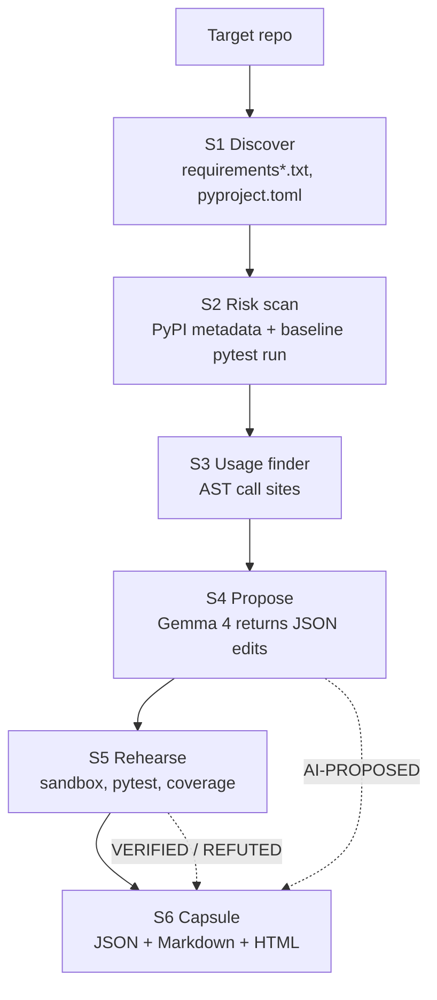

# 🧬 GemmaMorph

**Rehearse a dependency exit before you commit to it.**

GemmaMorph finds at-risk dependencies in a Python repository, shows exactly where they are used, asks **Gemma 4** to propose a replacement and migration, then *actually applies that migration in a sandbox and runs the tests*. Everything is written into a reusable **Dependency Exit Capsule** in which AI suggestions are always kept separate from facts that were observed or verified by execution.


> **Hacktober × ISTE KJSSE 2026 · Track 1: Gemma 4, Dependency Resilience**
> Team **JVSS** · Target repository: [`rishrek/LinkWatch`](https://github.com/rishrek/LinkWatch)
>
> ⚠️ The target is built for **Python 3.12 and 3.13 only**. Python 3.14 is not supported.

[Why](#-why-gemmamorph) •
[Pipeline](#-the-six-stage-pipeline) •
[Quick start](#-quick-start) •
[The Capsule](#-the-dependency-exit-capsule) •
[Gemma 4 usage](#-gemma-4-model-access-and-terms) •
[Example run](#-example-run-on-linkwatch) •
[Limitations](#-limitations)

---

## 💡 Why GemmaMorph

Maintainers usually learn that a dependency has decayed only when something breaks. Asking a chatbot "what should I replace this with?" doesn't fix that: the answer is unverified, and it is not tied to the real code.

GemmaMorph's rule is simple: **the model proposes, the machine verifies.**

| Step | Who does it | Evidence |
|---|---|---|
| Find dependencies and risks | Deterministic code (PyPI metadata, real test runs, AST) | `VERIFIED` / `OBSERVED` |
| Locate every usage | Python `ast`, no model | `VERIFIED` |
| Propose a replacement and exact edits | **Gemma 4** | `AI-PROPOSED` |
| Test original vs. replacement | Sandboxed venv + pytest + coverage | `VERIFIED`, or `REFUTED` if it fails |
| Executive summary | **Gemma 4** | `AI-GENERATED` |

No replacement table is hard-coded and no answers are pre-written. The model is given the real usage snippets and risk evidence for each dependency and everything it returns is checked against the files on disk.

---

## 🏗️ The six-stage pipeline



| Stage | Module | AI? | What it does |
|---|---|:-:|---|
| **S1 Discover** | `depexit/discover.py` | ❌ | Parses `requirements*.txt` (including `-r` includes) and `pyproject.toml` (`[project.dependencies]`, optional dependencies, dependency groups). Records file and line of every declaration, and flags specifiers across files that cannot both be satisfied. |
| **S2 Risk scan** | `depexit/risk_scan.py` | ❌ | Queries the live PyPI JSON API for stale or yanked releases, inactive classifiers, `requires_python` that excludes the running interpreter, and major-version lag. Then builds a **fresh venv**, installs the repo's requirements, runs the repo's own tests as a **baseline**, and attributes failures and warnings to the package that caused them. Also flags third-party imports that are never declared. |
| **S3 Usage finder** | `depexit/usage_finder.py` | ❌ | Walks every `.py` file with `ast` and records each import, attribute access, private-API use and monkeypatch of a flagged dependency, with file, line, enclosing function and a copy-pasteable snippet. |
| **S4 Propose** | `depexit/gemma_propose.py` | ✅ Gemma 4 | For **every** flagged dependency, sends the usage snippets and risk signals to Gemma 4 and expects one JSON object: replacement, rationale, exact `old_text → new_text` edits, requirement changes, suggested tests, expected gaps. Replies are schema-validated (with one corrective retry), and any edit whose `old_text` doesn't appear **exactly once** in the real file is dropped and logged. |
| **S5 Rehearse** | `depexit/rehearsal.py` | ❌ | Runs each proposal **individually** and then **all together** in throwaway copies of the repo, each with its own venv. Compares to the baseline: new failures, newly passing tests, added/removed warnings, and **edit coverage** (did the tests execute the changed lines at all?). Sets a verdict per proposal and generates a unified `proposed.patch`. |
| **S6 Capsule** | `depexit/capsule.py` | ✅ summary only | Writes the Dependency Exit Capsule. Gemma 4 writes only the short plain-English summary, tagged `AI-GENERATED`. |

Each stage ends as `ok`, `failed` or `skipped` with the real error or reason. A stage failing never prevents the capsule from being written. The process exit code is `1` if any stage failed, `2` for bad arguments, else `0`.

### How a proposal gets its verdict

| Verdict | Meaning |
|---|---|
| ✅ `verified` | Installs cleanly, introduces no new test failures, and the tests actually **executed** the edited lines |
| ⚠️ `unproven` | No new failures, but the edit was never executed by tests (or there was no baseline to compare against). Not evidence that it works. |
| ❌ `refuted` | Install failed, or a test that passed at baseline now fails |
| ⏳ `unrehearsed` | S5 was skipped or did not reach this proposal |

---

## 🏷️ Claim tags

AI output is never presented as fact. Every item in the capsule carries one of these tags:

| Tag | Meaning |
|---|---|
| `[VERIFIED]` | Produced by a command we ran (with its real exit code) or by deterministic parsing and AST analysis |
| `[OBSERVED]` | Seen in real run output (pytest warnings, tracebacks) or in PyPI metadata |
| `[AI-PROPOSED]` | Suggested by Gemma 4 and not yet proven |
| `[REFUTED]` | Proposed by Gemma 4, and a rehearsal showed it fails |
| `[AI-GENERATED]` | Prose written by Gemma 4 (the executive summary) |

---

## 🚀 Quick start

### Requirements

- **Python 3.12 or 3.13** (3.14 is not supported)
- Internet access (PyPI metadata and package installs inside the sandboxes)
- One Gemma 4 backend (see below)
- Optional: [`uv`](https://github.com/astral-sh/uv). If present, it is used for faster sandbox venvs, otherwise `venv` + `pip`.

### 1. Install

```bash
git clone <this-repository-url>
cd H26_JVSS_GemmaMorph1
python -m venv .venv && source .venv/bin/activate      # Windows: .venv\Scripts\activate
pip install -r requirements-gemmamorph.txt
```

> `requirements.txt` in this repo belongs to the LinkWatch code that ships alongside the tool. GemmaMorph itself needs only `requirements-gemmamorph.txt`.

### 2. Get the target repository

Analyse a **clean clone of LinkWatch**, not this repository's root:

```bash
git clone https://github.com/rishrek/LinkWatch.git ../LinkWatch
```

### 3. Choose a Gemma 4 backend

<details open>
<summary><b>Option A: Hosted (Gemini API)</b>: no local GPU needed</summary>

```bash
export GEMINI_API_KEY="your_key_here"          # Windows PowerShell: $env:GEMINI_API_KEY="..."
python run.py ../LinkWatch --hosted
```

Uses `gemma-4-26b-a4b-it` through the Gemini API by default.
</details>

<details>
<summary><b>Option B: Local (Ollama)</b>: runs fully offline for the model step</summary>

```bash
ollama pull gemma4:e2b
python run.py ../LinkWatch                      # ollama is the default backend
```

Uses `gemma4:e2b` at `http://localhost:11434` by default.
</details>

> **Environment variables are read from the shell, not from `.env`.** `.env.example` documents the variable names, but this code does not load a `.env` file automatically. Export them (or load the file with your shell/IDE) before running.

---

## 💻 CLI reference

```text
python run.py REPO [options]
```

| Option | Default | Description |
|---|---|---|
| `REPO` / `--repo PATH` | *(required)* | Path of the Python repo to analyse (give it once) |
| `--output DIR` | `./output` | Where the capsule files are written |
| `--backend {ollama,gemini}` | `ollama` | Model backend (env `GEMMA_BACKEND`) |
| `--hosted` | off | Shortcut for `--backend gemini` |
| `--model NAME` | `gemma4:e2b` / `gemma-4-26b-a4b-it` | Gemma 4 model name (env `GEMMA_MODEL`) |
| `--base-url URL` | backend default | Backend URL (env `GEMMA_BASE_URL`, or `OLLAMA_HOST` for Ollama) |
| `--num-ctx N` | `16384` | Ollama context window in tokens |
| `--skip-rehearsal` | off | Skip S5 (no sandbox runs) |
| `--keep-sandbox` | off | Keep temporary sandboxes for inspection |
| `--stale-years X` | `2.0` | Flag a latest release older than this many years |
| `--test-timeout S` | `600` | Seconds allowed per test run |

Precedence for model settings: CLI flag → environment variable → backend default. There is **no silent fallback** between backends and no canned answers: if the model is unreachable, the stage fails with the real error.

### Common runs

```bash
python run.py ../LinkWatch --hosted                        # full run, hosted Gemma 4
python run.py ../LinkWatch                                 # full run, local Gemma 4
python run.py ../LinkWatch --hosted --skip-rehearsal       # propose only, no sandbox runs
python run.py ../LinkWatch --hosted --keep-sandbox         # keep sandboxes to inspect them
python run.py ../LinkWatch --hosted --output ./capsule     # custom output folder
```

---

## 📦 The Dependency Exit Capsule

Written to `--output` (default `./output`):

| File | Purpose |
|---|---|
| `EXIT_CAPSULE.json` | Machine-readable, complete record: reusable by other tools or CI |
| `EXIT_CAPSULE.md` | Human-readable report for maintainers and pull-request descriptions |
| `EXIT_CAPSULE.html` | Self-contained single-file version for sharing |
| `proposed.patch` | Unified diff of all proposed edits and requirement changes (written when S5 runs and there is something to diff) |

Mapping to the Track 1 requirements:

| Capsule contains | Source | Tag |
|---|---|---|
| Dependency details (name, pin, file:line) | S1 | `VERIFIED` |
| Risk indicators (stale, lag, yanked, failures, undeclared) | S2 | `OBSERVED` / `VERIFIED` |
| Usage locations (file, line, function, snippet) | S3 | `VERIFIED` |
| Proposed replacement and migration steps (exact edits) | S4 | `AI-PROPOSED` |
| Suggested tests | S4 | `AI-PROPOSED` |
| Executed test results (baseline vs. each proposal vs. combined) | S5 | `VERIFIED` |
| Compatibility gaps (new failures, warnings, unexecuted edits, dropped edits) | S5 | `VERIFIED` / `REFUTED` |
| Open concerns and limitations | all stages + model's `expected_gaps` | mixed, tagged |
| Executive summary | S6 | `AI-GENERATED` |
| Provenance (model, backend, base URL, timestamp, per-stage status) | run | `VERIFIED` |

---

## 🤖 Gemma 4: model, access and terms

| | |
|---|---|
| **Model family** | Google Gemma 4 |
| **Hosted default** | `gemma-4-26b-a4b-it` via the Gemini API (`generativelanguage.googleapis.com`, key from `GEMINI_API_KEY`) |
| **Local default** | `gemma4:e2b` via Ollama's `/api/chat` with JSON mode |
| **Override** | `--model` / `GEMMA_MODEL`. Any other Gemma 4 variant the backend serves. |
| **Terms** | Gemma 4 is released under the **Apache 2.0** license ([model page](https://ai.google.dev/gemma)). Use of the hosted endpoint is additionally subject to the Gemini API terms. |
| **Settings** | Temperature `0.1`; JSON output requested (Ollama) and parsed/validated by us (both backends) |

**Where Gemma 4 is essential:** it reads the real usage snippets and risk evidence for each flagged dependency and produces the replacement choice, the exact code edits, the requirement changes, the suggested tests and the expected gaps. Without it there is nothing to rehearse. It is also asked for the capsule's short summary.

**What Gemma 4 is *not* trusted with:** discovering dependencies, measuring risk, finding usages, or deciding whether a migration works. Those are deterministic or execution-based.

---

## 🔬 Example run on LinkWatch

Stages S1–S3 are deterministic and need no model. This is what they observed on a fresh clone of `rishrek/LinkWatch` (Python 3.12):

**S1: 14 dependencies, 1 verified conflict**
- `pydantic==1.10.13` (`requirements.txt:5`) cannot be satisfied together with `pydantic>=2` (`pyproject.toml:17`)

**S2: 14 risk signals across 10 flagged dependencies**

| Dependency | Signal | Detail |
|---|---|---|
| `jinja2` | `test-failure` | `ImportError: cannot import name 'soft_unicode' from 'markupsafe'`, which breaks `tests.test_report::test_report_renders_all_sites` |
| `jinja2` | `version-lag` | pinned 2.11.3, latest 3.1.6 |
| `toml` | `stale-release` | last release 2020-11-01 (≈6 years) |
| `appdirs` | `stale-release` | last release 2020-05-11 (≈6.4 years) |
| `nose` | `stale-release` | last release 2015-06-02 (≈11 years) |
| `python-dateutil` | `stale-release` | last release 2024-03-01 |
| `pydantic`, `idna`, `chardet`, `setuptools` | `version-lag` | pinned versions a major version behind PyPI |
| `setuptools` | `test-warning` | `pkg_resources` deprecation, from `linkwatch/resources.py` |
| `certifi` | `undeclared-import` | imported in `linkwatch/checker.py`, not declared anywhere |

Baseline test run: **9 passed, 1 failed**.

**S3: 16 usages** across the 10 flagged dependencies (e.g. `jinja2` ×3, `certifi` ×2, `toml` ×2, `pydantic` ×2).

S4–S6 results (Gemma 4's proposals, per-proposal verdicts, combined-run comparison and `proposed.patch`) are generated by your own run and will differ by model and by day. Run the tool to produce them; nothing in this README is a substitute for the capsule.

---

## 🧪 Tests

GemmaMorph's own test-suite (no network or model needed):

```bash
pip install pytest
python -m pytest tests_depexit -q
```

The LinkWatch suite in `tests/` is the **target** that GemmaMorph runs inside its sandboxes. Note that its baseline is expected to contain a failure (see above).

---

## 🗂️ Repository layout

```text
.
├── run.py                    # orchestrator: runs S1–S6, prints a per-stage summary
├── depexit/
│   ├── discover.py           # S1  manifests -> dependencies, conflicts
│   ├── risk_scan.py          # S2  PyPI metadata + baseline test run + undeclared imports
│   ├── usage_finder.py       # S3  AST usage locations
│   ├── gemma_propose.py      # S4  Gemma 4 proposals, schema + edit validation
│   ├── rehearsal.py          # S5  sandboxed original-vs-replacement runs
│   ├── capsule.py            # S6  JSON / Markdown / HTML capsule
│   ├── llm.py                # Gemma 4 client (Ollama, Gemini API)
│   ├── testrun.py            # pytest runner + JUnit / warning parsing
│   ├── envs.py               # sandbox copy, venv (uv or pip), command runner
│   ├── edits.py              # exact-once old_text -> new_text edits
│   └── models.py             # typed data contract + claim tags
├── tests_depexit/            # unit tests for the tool
├── linkwatch/  tests/        # the target application and its tests (LinkWatch)
├── requirements-gemmamorph.txt   # dependencies of the tool
├── .env.example              # variable names (export them; not auto-loaded)
└── LICENSE
```

---

## ⚠️ Limitations

Stated plainly, because the capsule is meant to be trusted:

- **Python repositories only.** S1 reads `requirements*.txt` and PEP 621 / dependency-group tables in `pyproject.toml`. `[tool.poetry]` dependencies are reported as unparsed.
- **Verdicts are only as strong as the target's tests.** An edit the tests never execute is reported `unproven`, never `verified`. A passing run is not a proof of behavioural equivalence.
- **`requirements*.txt` only is rewritten** during rehearsal. Edits to `pyproject.toml` dependency lists are not applied in the sandbox.
- **Combined run depends on proposals not conflicting.** Edits that fail to apply are recorded as gaps rather than silently skipped.
- **Model output varies.** Small local models (e.g. `gemma4:e2b`) may return weaker edits than the hosted 26B model. Rejected or dropped edits are recorded in the capsule.
- **Network is required** for PyPI metadata and for installing packages in the sandboxes. If PyPI is unreachable, that dependency gets a `pypi-unavailable` note instead of invented data.
- **Running on your own repo executes its tests and installs its requirements** inside temporary virtual environments. Only point GemmaMorph at code you trust.

---

## 🤝 Contributing

Issues and pull requests are welcome. Please run `python -m pytest tests_depexit` before submitting.

## 👥 Team JVSS

Built for **Hacktober Hack Day Mumbai 2026**, hosted by ISTE KJSSE (K. J. Somaiya School of Engineering).

## 📄 License

Released under the [MIT License](LICENSE). Gemma 4 model weights are licensed separately under Apache 2.0.
