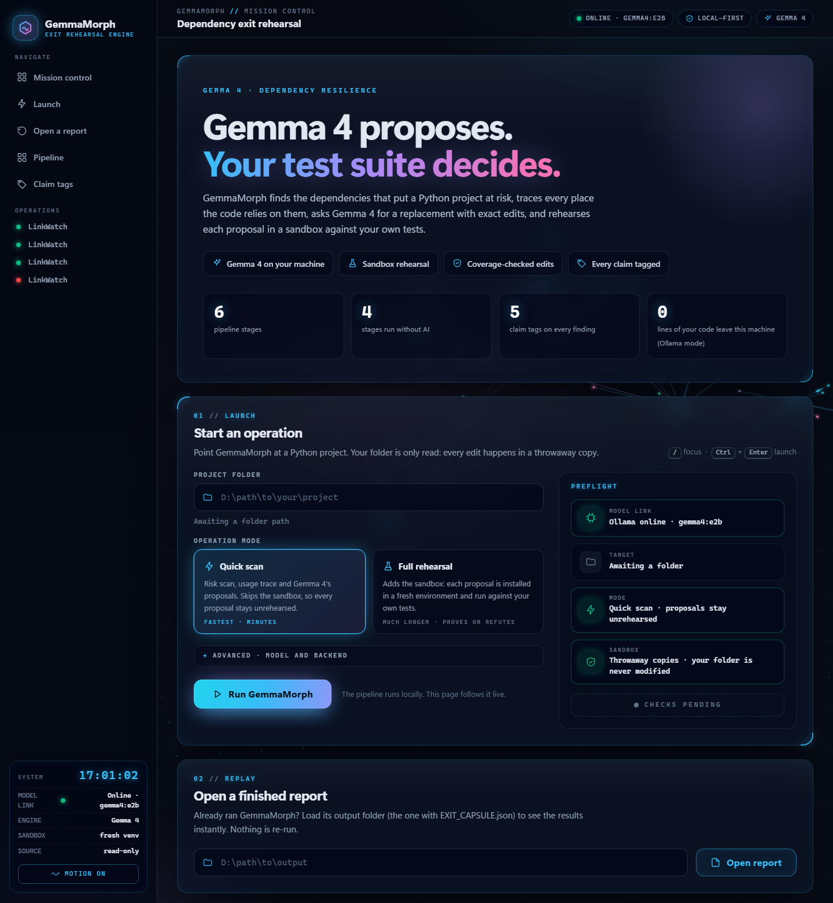
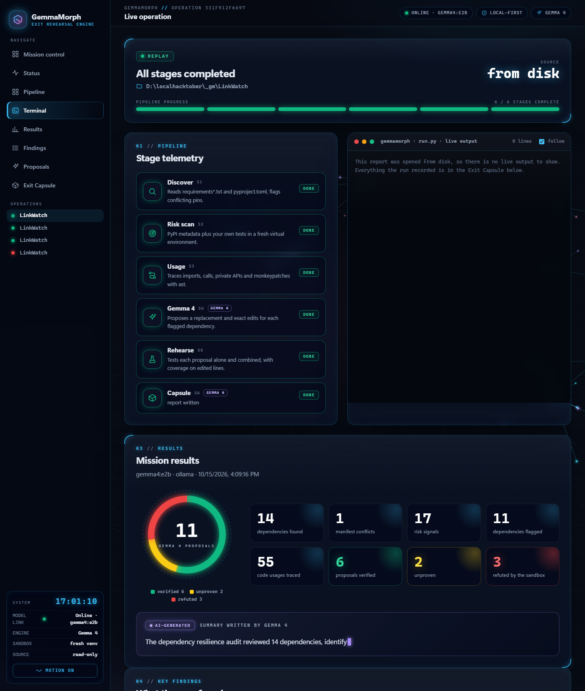
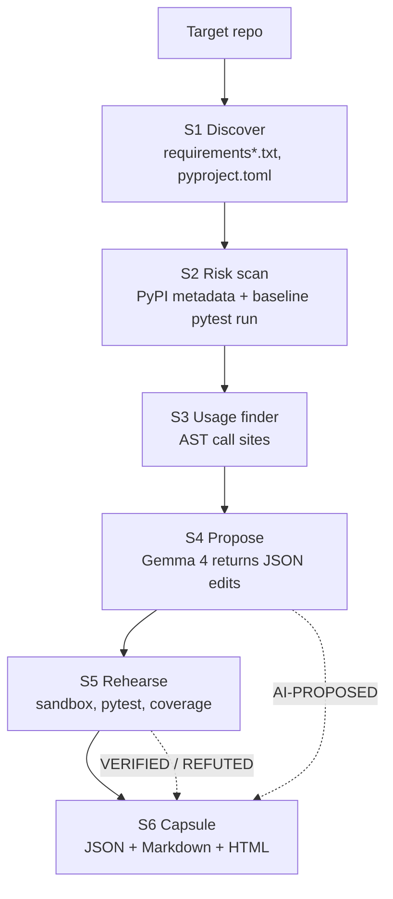

# 🧬 GemmaMorph

**Gemma 4 proposes. Your test suite decides.**

GemmaMorph finds the dependencies that put a Python project at risk, traces every place the code relies on them, asks **Gemma 4** for a replacement with exact edits, and then **rehearses each proposal in a sandbox against your own tests**. Everything lands in a **Dependency Exit Capsule** in which AI suggestions are always kept separate from facts that were observed or verified by running code.


> **Hacktober × ISTE KJSSE 2026 · Track 1: Gemma 4, Dependency Resilience** · Team **JVSS**
> Demo target: a fork of [`rishrek/LinkWatch`](https://github.com/rishrek/LinkWatch) (Python **3.12 / 3.13** only; 3.14 is not supported)

<p align="center">
  
  
</p>

[Why](#-why-gemmamorph) · [Quick start](#-quick-start-windows) · [The UI](#-the-web-ui) · [Pipeline](#-the-six-stage-pipeline) · [Verdicts](#-how-a-proposal-gets-its-verdict) · [Capsule](#-the-dependency-exit-capsule) · [Gemma 4](#-gemma-4-model-access-and-terms) · [Real run](#-a-real-run-on-linkwatch) · [Limitations](#-limitations) · [AI usage](#-ai-usage-disclosure)

---

## 💡 Why GemmaMorph

Maintainers usually learn that a dependency has decayed only when something breaks. Asking a chatbot "what should I replace this with?" does not fix that: the answer is unverified and not tied to the real code.

GemmaMorph's rule: **the model proposes, the machine verifies.**

| Step | Who does it | Evidence |
|---|---|---|
| Find dependencies and risks | Deterministic code: PyPI metadata, your real test runs, `ast` | `VERIFIED` / `OBSERVED` |
| Locate every usage, private-API call and monkeypatch | Python `ast`, no model | `VERIFIED` |
| Propose a replacement and exact edits | **Gemma 4** | `AI-PROPOSED` |
| Test original vs. replacement | Fresh venv + pytest + coverage | `VERIFIED`, or `REFUTED` if it fails |
| Plain-English summary | **Gemma 4** | `AI-GENERATED` |

What makes it different:

- **"Unproven" is a real verdict.** If no test executes the edited lines, GemmaMorph refuses to call the change safe.
- **Refuted proposals stay in the report** as evidence of what was ruled out.
- **Nothing is hard-coded.** No replacement tables, no pre-written answers: Gemma 4 receives the real usage snippets and risk evidence, and everything it returns is checked against the files on disk.
- **Local-first.** `gemma4:e2b` runs on a laptop through Ollama, so your source code never leaves the machine in the default mode.
- **Honest failures.** A failed stage shows its real error, later stages say why they were skipped, and the exit code is non-zero.

---

## 🚀 Quick start (Windows)

### Requirements

- **Python 3.12 or 3.13** (3.14 is not supported)
- Internet access (PyPI metadata, and package installs inside the sandboxes)
- One Gemma 4 backend: local **Ollama**, or the hosted **Gemini API**
- About **3 GB of free memory** for `gemma4:e2b` (close heavy apps first)
- Optional: [`uv`](https://github.com/astral-sh/uv). If present it builds the sandbox venvs faster; otherwise `venv` + `pip` is used.

### 1. Install

```powershell
git clone https://github.com/shaurya212121/H26_JVSS_GemmaMorph1.git
cd H26_JVSS_GemmaMorph1
python -m venv .venv
.venv\Scripts\Activate.ps1
pip install -r requirements-gemmamorph.txt
```

> The root `requirements.txt`, `pyproject.toml`, `linkwatch/` and `tests/` belong to **LinkWatch**, the starter project that ships alongside the tool (its original README is `README.linkwatch.md`). GemmaMorph itself needs only `requirements-gemmamorph.txt`.

### 2. Get a model

<details open>
<summary><b>Option A: local Gemma 4 with Ollama</b> (private, no API key)</summary>

```powershell
ollama pull gemma4:e2b
```

Ollama listens on `http://localhost:11434`. If your models live on another drive, set `OLLAMA_MODELS` (for example `D:\Ollamamodels`) before starting Ollama.
</details>

<details>
<summary><b>Option B: hosted Gemma 4 through the Gemini API</b></summary>

```powershell
$env:GEMINI_API_KEY = "your_key_here"
python run.py <repo> --hosted        # uses gemma-4-26b-a4b-it by default
```
</details>

> **Settings are read from the shell, not from `.env`.** `.env.example` only documents the variable names; the code does not load a `.env` file. Export the variables (or use the CLI flags) before running.

### 3. Get a target project

Analyse a **clean clone** of the project you care about. For the demo:

```powershell
git clone https://github.com/rishrek/LinkWatch.git ..\LinkWatch
```

> Don't point GemmaMorph at this repository's own root: the root also contains the tool's `requirements-gemmamorph.txt`, which would be read as the target's dependencies.

### 4. Run it

**With the UI (recommended):**

```powershell
python ui.py
```

Open <http://127.0.0.1:8765>, paste the project folder, press **Run GemmaMorph**.

**From the command line:**

```powershell
python run.py ..\LinkWatch
```

### Small C: drive? Keep the temp files elsewhere

The sandboxes create virtual environments and pip caches. Point them at a roomy drive before running:

```powershell
$env:TEMP = "D:\gm\tmp"; $env:TMP = $env:TEMP; $env:PIP_CACHE_DIR = "D:\gm\pip-cache"
```

---

## 🖥️ The web UI

`python ui.py` starts a local control room (standard library only; bound to `127.0.0.1`, so it is not reachable from other machines).

| Area | What you get |
|---|---|
| **Launch console** | Folder box with an instant "is this a Python project?" check, **Quick scan** vs **Full rehearsal** cards, advanced backend/model/URL fields, and a **preflight checklist** (model link, target, mode, sandbox) that ends in "All systems go" |
| **Live operation** | Segmented progress bar, six stage cards with a radar sweep on the running stage and real per-stage durations, a color-coded terminal streaming the actual output, a **Stop** button, and a "what went wrong" box with a fix-it hint when something fails |
| **Results** | Verdict donut, count-up tiles, the `AI-GENERATED` summary, **key findings** (failing tests, undeclared imports, private APIs, monkeypatches, stale or lagging pins), filterable **proposal cards** whose "Inspect" view shows Gemma 4's rationale and a red/green diff with a copy button |
| **Artifacts** | The Exit Capsule files and the HTML capsule embedded in the page |
| **Replay** | **Open a finished report** loads any output folder with an `EXIT_CAPSULE.json` instantly, without re-running anything. Runs from earlier sessions are restored automatically. |
| **Navigation** | Sidebar with scroll-spy, recent operations, a live model-link indicator, a motion on/off switch (reduced-motion is respected), and keyboard shortcuts: `/` focuses the folder box, `Ctrl` + `Enter` launches |

- **Quick scan** runs S1–S4 and skips the sandbox, so proposals stay `unrehearsed`. **Full rehearsal** also tests every proposal and takes much longer.
- It works **fully offline**: the animated background is drawn with plain canvas code and nothing loads from a CDN.
- Everything shown is read from the run's own `EXIT_CAPSULE.json` and log; the UI invents nothing.
- Safety: only `EXIT_CAPSULE.html/.md/.json` and `proposed.patch` are served from a run's folder, paths cannot escape it, and all dynamic text is escaped.

Options: `python ui.py --port 9000 --runs-dir D:\gm\ui_runs --no-browser`.

---

## 🏗️ The six-stage pipeline



| Stage | Module | AI? | What it does |
|---|---|:-:|---|
| **S1 Discover** | `depexit/discover.py` | ❌ | Parses `requirements*.txt` (including `-r` includes) and `pyproject.toml` (dependencies, optional dependencies, dependency groups). Normalizes names, records the file and line of every declaration, and flags specifiers across files that cannot both be satisfied. |
| **S2 Risk scan** | `depexit/risk_scan.py` | ❌ | Reads PyPI JSON metadata (stale or yanked releases, inactive classifiers, `requires_python` that excludes the running interpreter, major-version lag). Builds a **fresh venv**, installs the repo's requirements, runs the repo's own tests as a **baseline**, and maps warnings and failures to the package that caused them. Flags imports that are never declared. |
| **S3 Usage** | `depexit/usage_finder.py` | ❌ | Walks every `.py` file with `ast` and records each import, attribute use, **private-API call** and **monkeypatch** of a dependency, with file, line, enclosing function and a copy-pasteable snippet. A private-API or monkeypatch use becomes a `VERIFIED` risk signal of its own. |
| **S4 Propose** | `depexit/gemma_propose.py` | ✅ Gemma 4 | For **every** flagged dependency, sends the usage snippets and risk signals to Gemma 4 and expects one JSON object: replacement, rationale, exact `old_text → new_text` edits, requirement changes, suggested tests, expected gaps. Replies are schema-validated (one corrective retry), and any edit whose `old_text` does not appear **exactly once** in the real file is dropped and logged. |
| **S5 Rehearse** | `depexit/rehearsal.py` | ❌ | Tries each proposal **alone**, then the surviving ones **together**, in throwaway copies of the repo, each with its own venv. Compares with the baseline (new failures, newly passing tests, warnings) and measures **edit coverage**: did the tests execute the changed lines at all? Writes `proposed.patch`. |
| **S6 Capsule** | `depexit/capsule.py` | ✅ summary only | Writes the Exit Capsule. Gemma 4 writes only the short summary, tagged `AI-GENERATED`. |

Each stage ends as `ok`, `failed` or `skipped` with the real error or reason, and a failing stage never prevents the capsule from being written. Exit code: `1` if any stage failed, `2` for bad arguments, otherwise `0`.

### How a proposal gets its verdict

| Verdict | Meaning |
|---|---|
| ✅ `verified` | Installs cleanly, no test that passed at baseline fails, and every applied edit was exercised (edits to `requirements*.txt` / `pyproject.toml` count as exercised by the install plus the test run). If a baseline failure now passes, the reason says so. |
| ⚠️ `unproven` | No new failures, but an edit was never executed by the tests, a deletion has no executable lines, the baseline had no tests to compare against, or the sandbox could not be created. Not evidence that it works. |
| ❌ `refuted` | The install failed, a baseline-passing test now fails, or the test suite can no longer run (the real error line is reported). Tag becomes `REFUTED`. |
| ⏳ `unrehearsed` | S5 was skipped (Quick scan) or did not reach this proposal |

The combined run and `proposed.patch` include only proposals that were **not** refuted on their own.

---

## 🏷️ Claim tags

AI output is never presented as fact. Every item carries one of these tags:

| Tag | Meaning |
|---|---|
| `[VERIFIED]` | Produced by a command we ran (with its real exit code) or by deterministic parsing and AST analysis |
| `[OBSERVED]` | Seen in real run output (pytest warnings, tracebacks) or in PyPI metadata |
| `[AI-PROPOSED]` | Suggested by Gemma 4 and not yet proven |
| `[REFUTED]` | Proposed by Gemma 4, and a rehearsal showed it fails |
| `[AI-GENERATED]` | Prose written by Gemma 4 (the summary) |

---

## 💻 CLI reference

```text
python run.py REPO [options]
```

| Option | Default | Description |
|---|---|---|
| `REPO` / `--repo PATH` | *(required)* | Python project to analyse (give it once) |
| `--output DIR` | `./output` | Where the capsule files are written |
| `--backend {ollama,gemini}` | `ollama` | Model backend (env `GEMMA_BACKEND`) |
| `--hosted` | off | Shortcut for `--backend gemini` |
| `--model NAME` | `gemma4:e2b` / `gemma-4-26b-a4b-it` | Gemma 4 model name (env `GEMMA_MODEL`) |
| `--base-url URL` | backend default | Backend URL (env `GEMMA_BASE_URL`, or `OLLAMA_HOST` for Ollama) |
| `--num-ctx N` | `16384` | Ollama context window in tokens |
| `--skip-rehearsal` | off | Skip S5 (no sandbox runs) |
| `--keep-sandbox` | off | Keep temporary sandboxes for inspection |
| `--stale-years X` | `2.0` | Flag a latest release older than this many years |
| `--test-timeout S` | `600` | Seconds allowed per test run |

Precedence for model settings: CLI flag → environment variable → backend default. There is **no silent fallback** between backends and no canned answers: if the model is unreachable, the stage fails with the real error.

```powershell
python run.py ..\LinkWatch                              # full run, local Gemma 4
python run.py ..\LinkWatch --hosted                     # full run, hosted Gemma 4
python run.py ..\LinkWatch --skip-rehearsal             # propose only, no sandbox runs
python run.py ..\LinkWatch --output .\capsule           # custom output folder
```

---

## 📦 The Dependency Exit Capsule

Written to `--output` (default `./output`):

| File | Purpose |
|---|---|
| `EXIT_CAPSULE.json` | Complete machine-readable record, reusable by other tools or CI |
| `EXIT_CAPSULE.md` | Human-readable report for maintainers and pull-request descriptions |
| `EXIT_CAPSULE.html` | Self-contained single-file version for sharing (no external resources) |
| `proposed.patch` | Unified diff of the proposals that were not refuted (written when S5 ran and something changes) |

| The capsule contains | Source | Tag |
|---|---|---|
| Dependencies (name, pin, file:line) and manifest conflicts | S1 | `VERIFIED` |
| Risk signals (stale, lag, yanked, test failures and warnings, undeclared imports, private APIs, monkeypatches) | S2, S3 | `OBSERVED` / `VERIFIED` |
| Usage locations (file, line, function, snippet) | S3 | `VERIFIED` |
| Proposed replacements and exact edits, suggested tests, expected gaps | S4 | `AI-PROPOSED` |
| Baseline vs. each proposal vs. combined test results, edit coverage | S5 | `VERIFIED` |
| Verdict per proposal, with reasons (refuted proposals are kept) | S5 | `VERIFIED` / `REFUTED` |
| Executive summary | S6 | `AI-GENERATED` |
| Provenance (model, backend, URL, timestamp, per-stage status) | run | `VERIFIED` |

A real capsule from the finished code is in [`samples/linkwatch/`](samples/linkwatch/).

---

## 🤖 Gemma 4: model, access and terms

| | |
|---|---|
| **Model family** | Google Gemma 4 |
| **Hosted default** | `gemma-4-26b-a4b-it` through the Gemini API (key from `GEMINI_API_KEY`) |
| **Local default** | `gemma4:e2b` through Ollama's `/api/chat` with JSON mode |
| **Override** | `--model` / `GEMMA_MODEL`: any other Gemma 4 variant the backend serves |
| **Terms** | See the [Gemma model page](https://ai.google.dev/gemma) for the license of the weights; the hosted endpoint is additionally subject to the Gemini API terms |
| **Settings** | Temperature `0.1`; JSON output requested (Ollama) and always parsed and validated by us (both backends) |

**Where Gemma 4 is essential:** it reads the real usage snippets and risk evidence for each flagged dependency and produces the replacement, the exact edits, the requirement changes, the suggested tests and the expected gaps. Without it there is nothing to rehearse. It also writes the capsule's short summary.

**What Gemma 4 is *not* trusted with:** discovering dependencies, measuring risk, finding usages, or deciding whether a migration works. Those are deterministic or execution-based.

---

## 🔬 A real run on LinkWatch

This is the real capsule from a full run of the pipeline on a clean clone of `rishrek/LinkWatch` (2026-10-15, model `gemma4:e2b` through Ollama). Files: [`samples/linkwatch/`](samples/linkwatch/) (see its `SAMPLE.md`).

**14 dependencies · 1 manifest conflict (`pydantic==1.10.13` vs `>=2`) · 17 risk signals · 55 usages traced · 11 Gemma 4 proposals: 6 verified, 2 unproven, 3 refuted**

What the deterministic stages found: a failing baseline test caused by Jinja2 2.11.3 (`ImportError: cannot import name 'soft_unicode' from 'markupsafe'`), an undeclared `certifi` import, a private `requests.utils._parse_content_type_header` call, and a runtime monkeypatch of `requests.Session.request`.

| Dependency | Gemma 4 replacement | Rehearsal verdict | Tag |
|---|---|---|---|
| `appdirs` | - | unproven | AI-PROPOSED |
| `certifi` | certifi | verified | AI-PROPOSED |
| `chardet` | chardet | verified | AI-PROPOSED |
| `idna` | idna | unproven | AI-PROPOSED |
| `jinja2` | jinja2 | verified | AI-PROPOSED |
| `nose` | - | verified | AI-PROPOSED |
| `pydantic` | pydantic | refuted | REFUTED |
| `python-dateutil` | - | verified | AI-PROPOSED |
| `requests` | - | refuted | REFUTED |
| `setuptools` | importlib.resources | verified | AI-PROPOSED |
| `toml` | stdlib:tomllib | refuted | REFUTED |

For example, Gemma 4 proposed replacing `toml` with the standard library's `tomllib`, and the sandbox **refuted** it: the edit passes a path where `tomllib.load` needs a binary file handle, so `test_sites_file_loads` fails. Results vary by model and by day; every verdict above comes from an executed test run.


---

## 🧪 Tests

The tool's own suite needs no network, no model and no GPU:

```powershell
pip install pytest
python -m pytest tests_depexit -q
```

It covers every stage with a fake LLM (good, malformed and hallucinated-edit replies), the exit codes, the sandbox verdict rules, and the UI server. (The UI test that syntax-checks the browser scripts runs when Node.js is installed.)

The LinkWatch suite in `tests/` is the **target** that GemmaMorph runs inside its sandboxes. Its baseline is expected to contain one failure (see above).

---

## 🗂️ Repository layout

```text
.
├── run.py                       # orchestrator: runs S1–S6, prints per-stage status
├── ui.py                        # local web UI server
├── ui_static/                   # UI styles and scripts (no external resources)
├── depexit/
│   ├── discover.py              # S1  manifests -> dependencies, conflicts
│   ├── risk_scan.py             # S2  PyPI metadata + baseline test run + undeclared imports
│   ├── usage_finder.py          # S3  AST usages, private APIs, monkeypatches
│   ├── gemma_propose.py         # S4  Gemma 4 proposals, schema + edit validation
│   ├── rehearsal.py             # S5  sandboxed runs, coverage, verdicts, patch
│   ├── capsule.py               # S6  JSON / Markdown / HTML capsule
│   ├── llm.py                   # Gemma 4 client (Ollama, Gemini API)
│   ├── testrun.py               # pytest runner + JUnit / warning parsing
│   ├── envs.py                  # sandbox copy, venv (uv or pip), command runner
│   ├── edits.py                 # exact-once old_text -> new_text edits
│   └── models.py                # typed data contract + claim tags
├── tests_depexit/               # offline tests for the tool
├── samples/linkwatch/           # a real capsule produced by this code
├── docs/                        # README screenshots
├── linkwatch/  tests/           # the target application and its tests (LinkWatch)
├── README.linkwatch.md          # LinkWatch's original README
├── requirements-gemmamorph.txt  # dependencies of the tool
└── .env.example                 # variable names (export them; not auto-loaded)
```

---

## 🛠️ Troubleshooting

| Symptom | Fix |
|---|---|
| The UI shows **"Ollama offline"** | Start Ollama, then `ollama pull gemma4:e2b`. The stage error says `Cannot reach ollama at ...`. |
| Ollama fails with **"failed to allocate buffer"** or out-of-memory | Windows could not give the model enough memory. Close heavy apps (browsers, Docker, WSL), then retry. If the system drive is nearly full, free space or move the pagefile to a roomy drive. |
| Sandbox installs fail with **"No space left on device"** | Set `TEMP`, `TMP` and `PIP_CACHE_DIR` to a drive with space (see above). |
| **"Gemini API: GEMINI_API_KEY is not set"** | Export the key in the same shell, or use the local backend. |
| A run is slow | A Full rehearsal builds one fresh venv and runs the target's tests per proposal. Use **Quick scan** (or `--skip-rehearsal`) to skip it. |
| Port 8765 is busy | `python ui.py --port 9000` |

---

## ⚠️ Limitations

Stated plainly, because the capsule is meant to be trusted:

- **Python repositories only.** S1 reads `requirements*.txt` and PEP 621 / dependency-group tables in `pyproject.toml`. `[tool.poetry]` dependencies are reported as unparsed.
- **Verdicts are only as strong as the target's tests.** An edit the tests never execute is `unproven`, never `verified`, and a passing run is not a proof of behavioural equivalence.
- **Requirement removals** are applied to `requirements*.txt` and to `pyproject.toml` dependency lists; **additions** go to the first requirements file (or are installed directly if there is none).
- **The combined run** uses only proposals that survived on their own. Edits that fail to apply are recorded as gaps rather than skipped silently.
- **Model output varies.** Small local models (for example `gemma4:e2b`) propose weaker edits than the hosted 26B model, and some are plainly wrong. Catching those is what the rehearsal is for, and refuted proposals stay in the capsule.
- **Network is required** for PyPI metadata and package installs. If PyPI is unreachable, that dependency gets a `pypi-unavailable` signal instead of invented data.
- **Running on a repo executes its tests and installs its requirements** inside temporary virtual environments. Only point GemmaMorph at code you trust.

---

## 🤖 AI usage disclosure

- **At runtime**, GemmaMorph uses **Gemma 4** (locally through Ollama, or through the Gemini API) for two jobs only: the replacement proposals with exact edits (S4) and the short summary (S6). Every other stage is deterministic code.
- **While building it**, parts of this project's code, tests, UI and documentation were written with **AI coding assistance** (Anthropic's Claude, through Claude Code). The team reviewed and tested that work: the offline test suite and the real runs on LinkWatch are the evidence.
- **Pre-existing code:** `linkwatch/`, `tests/`, `Dockerfile`, `Makefile`, `pyproject.toml`, `requirements.txt`, `requirements-dev.txt` and `sites.toml` come from the starter project [`rishrek/LinkWatch`](https://github.com/rishrek/LinkWatch) and are used as the demo target. They are not part of the tool.

## 👥 Team JVSS

Built for **Hacktober Hack Day Mumbai 2026**, hosted by ISTE KJSSE (K. J. Somaiya School of Engineering).

## 📄 License

Released under the [MIT License](LICENSE).
